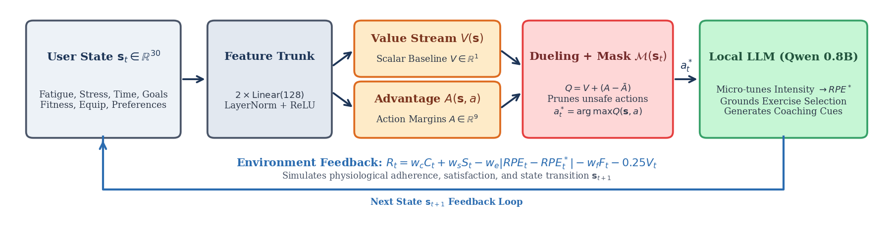
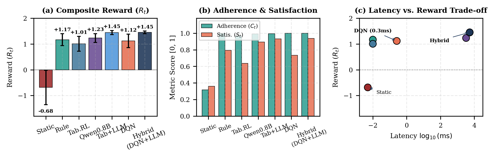
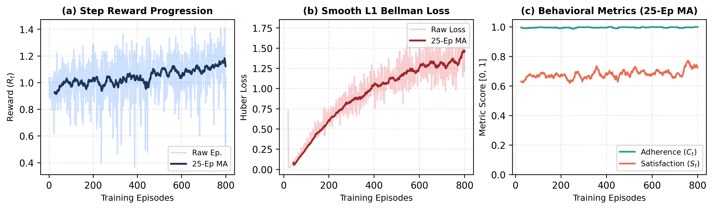

# HybridTrainer: Continuous-State Deep Reinforcement Learning and Grounded Local LLM Synthesis for Adaptive Workout Recommendation

**Author:** Harry Hennessy  
**Institution:** Rochester Institute of Technology  
**Project:** Capstone Project in Artificial Intelligence

---

## 1. Project Overview

**HybridTrainer** is a personalized, adaptive physical exercise recommendation framework designed to run on local hardware. Traditional fitness applications rely on static gym routines that ignore day-to-day fluctuations in user fatigue, stress, and available time—frequently leading to overtraining, injury, or schedule abandonment. Conversely, pure generative Large Language Models (LLMs) can hallucinate unavailable equipment, lack sequential state awareness, and introduce privacy risks when streaming biometric data to external cloud APIs.

HybridTrainer resolves these limitations through a **two-stage hybrid architecture**:
1. **Macro-Level Neural RL (Dueling Double DQN):** A continuous-state Deep Q-Network evaluates high-dimensional user physiological states ($\mathbf{s}_t \in \mathbb{R}^{30}$) and prescribes mathematically certified, constraint-safe macro-actions (modality, intensity envelope, duration ceiling).
2. **Micro-Level Language Synthesis (On-Device LLM):** An on-device small language model (`qwen3.5:0.8b` via Ollama) receives the verified macro-decision and user state, micro-calibrates continuous intensity to match target Borg RPE, selects equipment-grounded exercises, and generates tailored coaching rationales.



---

## 2. Directory Hierarchy

```
IDAI_Capstone/
├── assets/                               # Publication figures & architecture diagrams
│   ├── framework_architecture.png        # System architecture flow diagram
│   ├── ckpt3_comparison.png              # Benchmark comparison across all 7 paradigms
│   ├── dqn_training_curve.png            # 800-episode DQN reward, loss, & adherence curves
│   └── rl_learning_curve.svg             # Baseline tabular Q-learning curve
├── Baseline/                             # Baseline Experiments
│   ├── config.py                         # Global hyperparameters, seeds, and paths
│   ├── demo.py                           # Interactive CLI demo for baseline models
│   ├── train_rl.py                       # Tabular Q-learning training script
│   ├── data/                             # Sensor dataset ingestion & preprocessing
│   │   ├── fitrec.py                     # FitRec GPS & heart rate log parsing
│   │   ├── pamap2.py                     # PAMAP2 IMU & heart rate exertion mapping
│   │   ├── wesad.py                      # WESAD physiological stress detection
│   │   └── prepare_data.py               # Unified dataset inspection & caching driver
│   ├── environment/                      # Physiological simulation environment
│   │   ├── schemas.py                    # Data classes (UserState, WorkoutAction, Validation)
│   │   ├── exercises.py                  # 20-exercise catalogue with equipment & intensity bounds
│   │   ├── reward.py                     # Simulated feedback (completion, satisfaction, Borg RPE, fatigue)
│   │   └── synthetic_users.py            # Calibrated synthetic user state generator
│   ├── policies/                         # Baseline recommendation policies
│   │   ├── base.py                       # Abstract BasePolicy interface
│   │   ├── static_schedule.py            # Non-adaptive 4-day gym split
│   │   ├── rule_based.py                 # Deterministic expert heuristics
│   │   ├── rl_qlearning.py               # Discretized 108-bin tabular Q-learning
│   │   └── llm_ollama.py                 # Pure local Qwen 3.5 0.8B zero-shot policy
│   ├── evaluation/                       # Benchmark harness & validation metrics
│   ├── tests/                            # Automated test suite
│   └── outputs/                          # Serialized Q-tables, summaries, & training logs
├── Implementation/                       # Novel Core Implementation (Dueling DDQN + Hybrid LLM)
│   ├── model.py                          # PyTorch DuelingDQN architecture (Value & Advantage heads)
│   ├── state_encoder.py                  # 30-dimensional continuous state vector encoder
│   ├── replay_buffer.py                  # Uniform Experience Replay Buffer (N=25,000)
│   ├── dqn_agent.py                      # Dueling DDQN agent with dynamic action masking & Huber loss
│   ├── hybrid_policy.py                  # Hybrid RL-LLM policy with continuous Borg RPE micro-tuning
│   ├── train_dqn.py                      # 800-episode neural RL training pipeline & checkpointing
│   ├── evaluate.py                       # Comprehensive 7-paradigm held-out evaluation benchmark
│   ├── demo.py                           # Interactive batch demo on held-out user profiles
│   └── outputs/                          # Trained models (dqn_model.pt), checkpoints, & logs
├── Data/                                 # Dataset documentation & download instructions
│   ├── FitRec/README.md                  # Endomondo workout route dataset details & links
│   ├── PAMAP2/README.md                  # Physical activity monitoring dataset details & links
│   └── WESAD/README.md                   # Wearable stress & affect detection dataset details & links
├── Synthetic_User_Data/                  # Calibrated synthetic cohort profiles
│   ├── populate_synthetic_users.py       # 10,000-user generator calibrated by sensor priors
│   ├── synthetic_users_10k.csv           # Calibrated synthetic cohort in CSV format
│   ├── synthetic_users_10k.jsonl         # Calibrated synthetic cohort in JSONL format
│   └── synthetic_users_summary.json      # Distribution statistics (fitness tiers, goals, equipment)
├── requirements.txt                      # Project dependencies (PyTorch, NumPy, Matplotlib, Pytest)
├── .gitignore                            # Excludes large raw sensor files (~30 GB) & caches
└── README.md                             # Complete project documentation
```

---

## 3. Environment & Dependency Installation

### Prerequisites
* **Python:** Version 3.10, 3.11, or 3.12 (CPU-ready; GPU optional).
* **Ollama (Optional, for Local LLM):** Download and install [Ollama](https://ollama.com/) for local, on-device language model execution without cloud API keys.

### 1. Clone the Repository & Set Up Environment
```bash
git clone https://github.com/hhennessy20/HybridTrainer.git
cd HybridTrainer

# Create and activate a virtual environment
python -m venv venv

# Windows (PowerShell):
.\venv\Scripts\Activate.ps1

# Linux / macOS:
source venv/bin/activate
```

### 2. Install Dependencies
```bash
pip install -r requirements.txt
```

### 3. Set Up Local Ollama Model
If you wish to run the local language model synthesis:
```bash
# Start Ollama service
ollama serve

# Pull the lightweight, privacy-preserving Qwen model
ollama pull qwen3.5:0.8b
```
*(Note: If Ollama is offline or not installed, all scripts automatically detect this and run using `--no-llm`).*

---

## 4. Data Preparation & Calibration

HybridTrainer bridges public sensor datasets with an in-silico physiological user environment to evaluate workout adaptation without human clinical trial safety hazards.

### Sensor Datasets
The raw datasets comprise ~30 GB of continuous multi-modal data:
1. **FitRec (Endomondo):** 167,373 workouts across 956 users, calibrating realistic workout duration distributions ($\mu=87.9 \pm 52.4$ min) and sport modality frequencies.
2. **PAMAP2:** 401,696 sensor rows across 9 subjects, mapping physical activities to empirical heart rate ranges to scale the Borg CR10 perceived exertion model.
3. **WESAD:** $>8.8 \times 10^6$ physiological sensor samples across 15 subjects, grounding electrodermal activity (EDA) spikes to calibrate a 20% empirical daily stress spike probability.

To inspect and compute summary distributions from local copies of the datasets:
```bash
python Baseline/data/prepare_data.py --dataset all
```
*See [`Data/FitRec/README.md`](Data/FitRec/README.md), [`Data/PAMAP2/README.md`](Data/PAMAP2/README.md), and [`Data/WESAD/README.md`](Data/WESAD/README.md) for download URLs and paper citations.*

### Synthetic Cohort Generation
Using the empirical priors from FitRec, PAMAP2, and WESAD, a calibrated cohort of 10,000 synthetic user profiles is generated across balanced fitness tiers (beginner, intermediate, advanced) and goals (endurance, strength, general fitness, weight loss):
```bash
python Synthetic_User_Data/populate_synthetic_users.py --count 10000
```

### Data Partitioning Strategy
To guarantee zero data contamination across training, validation, and benchmarking:
* **Training Partition (Seeds 1000–1799):** Dedicated block `[1000, 1999]` for policy optimization (Seeds 1000–1499 for 500-episode Tabular RL; Seeds 1000–1799 for 800-episode Dueling DDQN, totaling 12,000 environment transitions).
* **Validation Partition (Seeds 2000–2024):** 25 multi-day episodes for hyperparameter tuning.
* **Held-Out Test Partition (Seeds 3000–3024):** 25 unseen scenarios strictly reserved for comparative benchmarking.
* **Interactive Demo Scenario (Seeds 1-100):** Canonical held-out profile for side-by-side inference demonstration.

---

## 5. Execution Guide: Training & Testing

### A. Run Interactive Batch Demo
Run inference across a batch of held-out user profiles and compare all policies on the canonical demo scenario:
```bash
# With local Ollama Qwen model:
python Implementation/demo.py --batch-size 3

# Offline mode (without Ollama):
python Implementation/demo.py --batch-size 3 --no-llm
```

### B. Run the Baseline Demo
Execute the four foundational baseline models on the canonical user profile:
```bash
python Baseline/demo.py
```

### C. Run the Comprehensive 7-Paradigm Benchmark
Evaluate all 7 recommendation paradigms across the 25 held-out benchmark scenarios:
```bash
python Implementation/evaluate.py --scenarios 25
```
Outputs are written to:
* `Implementation/outputs/evaluation_summary.json`
* `Implementation/outputs/evaluation_summary.csv`
* `Implementation/outputs/evaluation_scenarios.csv`

### D. Train Models from Scratch
To retrain the continuous neural RL agent:
```bash
# Train Dueling Double DQN (800 episodes, saves checkpoints and curves):
python Implementation/train_dqn.py --episodes 800

# Train Tabular Q-Learning baseline (500 episodes):
python Baseline/train_rl.py --episodes 500
```

### E. Run Automated Smoke Tests
Validate core schemas, action validation logic, synthetic generators, and reward functions:
```bash
python Baseline/tests/run_smoke_tests.py
```

---

## 6. Key Empirical Results

### Quantitative Benchmark Comparison
All models were evaluated across the identical 25 held-out test scenarios (`seeds 3000–3024`) under the simulated physiological environment ($R_t = w_c C_t + w_s S_t - w_e |RPE_t - RPE^*_t| - w_f F_t - 0.25 V_t$):

| Paradigm | Policy Description | Mean Reward ($R_t$) | Adherence ($C_t$) | Satisfaction ($S_t$) | Borg CR10 Error | Violations (%) | Time Overrun (%) | Latency (CPU) |
| :--- | :--- | :---: | :---: | :---: | :---: | :---: | :---: | :---: |
| **Static** | Rigid 4-day gym split | $-0.685 \pm 0.667$ | $0.32$ | $0.36$ | $2.35$ | $92.0\%$ | $84.0\%$ | $<\!0.01$ ms |
| **Rule-Based** | Expert heuristics | $+1.169 \pm 0.229$ | $\mathbf{1.00}$ | $0.79$ | $1.08$ | $\mathbf{0.0\%}$ | $\mathbf{0.0\%}$ | $0.01$ ms |
| **Tabular RL** | 108-bin discrete Q-table | $+1.008 \pm 0.290$ | $0.97$ | $0.64$ | $1.35$ | $\mathbf{0.0\%}$ | $\mathbf{0.0\%}$ | $0.01$ ms |
| **Local LLM** | Pure Qwen 3.5 0.8B zero-shot | $+1.234 \pm 0.172$ | $0.99$ | $0.90$ | $0.88$ | $\mathbf{0.0\%}$ | $\mathbf{0.0\%}$ | $3,288$ ms |
| **Tabular+LLM** | Tabular RL + LLM synthesis | $+1.448 \pm 0.077$ | $0.99$ | $0.93$ | $\mathbf{0.04}$ | $\mathbf{0.0\%}$ | $\mathbf{0.0\%}$ | $5,345$ ms |
| **Dueling DQN** | Continuous Neural RL | $+1.119 \pm 0.260$ | $\mathbf{1.00}$ | $0.74$ | $1.20$ | $\mathbf{0.0\%}$ | $\mathbf{0.0\%}$ | $\mathbf{0.26}$ ms |
| **HybridTrainer**| **Dueling DQN + LLM Synthesis** | $\mathbf{+1.455 \pm 0.052}$ | $\mathbf{1.00}$ | $\mathbf{0.94}$ | $\mathbf{0.04}$ | $\mathbf{0.0\%}$ | $\mathbf{0.0\%}$ | $5,386$ ms |



### Key Findings & Analysis
1. **Safety & Adherence:** Dueling DQN achieves **100% adherence and zero constraint violations** at an inference latency of **0.26 milliseconds**. Dynamic action masking $\mathcal{M}(\mathbf{s}_t)$ mathematically guarantees that extreme fatigue ($\ge 0.80$) or time deficits ($<25$ min) cannot trigger dangerous high-strain workouts.
2. **Micro-Tuning Synergy:** Fixed discrete RL policies are constrained to coarse intensity tiers ($4.5, 6.0, 7.5$), leaving residual Borg RPE errors of $1.1$ to $1.4$. In HybridTrainer, the local LLM receives the verified macro-decision and micro-calibrates continuous intensity (e.g., tuning $4.5 \rightarrow 3.4$ for a beginner with low fatigue), plunging Borg CR10 error to **$0.04$** and driving composite reward to **$+1.455$** with tight variance ($\pm 0.05$).
3. **Training Stability in Continuous State Space:** As shown in the training progression curves below, the Dueling Double DQN agent demonstrates steady step reward progression from $+0.97 \rightarrow +1.13$ and 100% adherence over 800 episodes. The Huber loss scales up naturally as predicted Q-values grow from zero initialization up to cumulative multi-day discounted returns ($\approx 15$ to $20$).



---

## 7. Method Formulation Summary

### State Space ($\mathcal{S} \in \mathbb{R}^{30}$)
The user state $\mathbf{s}_t$ is represented as a normalized continuous 30-dimensional tensor:
* 5 continuous scalar features: fatigue $\in [0, 1]$, mental stress $\in [0, 1]$, historical adherence rate $\in [0, 1]$, normalized target Borg RPE $\in [0, 1]$, and normalized time availability $\in [0, 1]$.
* 3 one-hot indicators for fitness level (`beginner`, `intermediate`, `advanced`).
* 4 one-hot indicators for primary goal (`endurance`, `strength`, `general_fitness`, `weight_loss`).
* 8 multi-hot equipment masks (`bodyweight`, `dumbbells`, `barbell`, `kettlebell`, `pullup_bar`, `cable_machine`, `stationary_bike`, `treadmill`).
* 10 preference and dispreference flags.

### Action Space ($\mathcal{A}$, $|\mathcal{A}|=9$)
Nine discrete macro-actions balancing modality, intensity, and duration:
* $a_0$: Active Recovery (intensity 2.5, 30 min)
* $a_1$: Flexibility & Mobility (intensity 2.5, 25 min)
* $a_2$: Light Aerobic Endurance (intensity 4.5, 30 min)
* $a_3$: Moderate Aerobic Endurance (intensity 6.0, 40 min)
* $a_4$: High-Volume Endurance (intensity 7.5, 50 min)
* $a_5$: Light Hypertrophy Strength (intensity 5.0, 35 min)
* $a_6$: Moderate Compound Strength (intensity 6.5, 45 min)
* $a_7$: High-Intensity Interval Training (intensity 7.5, 25 min)
* $a_8$: General Conditioning Circuit (intensity 5.5, 40 min)

### Dueling Double DQN Objective

The Q-network decouples state value $V(\mathbf{s})$ from action advantages $A(\mathbf{s}, a)$ to stabilize learning in low-variance states:

$$
Q(\mathbf{s}, a; \theta) = V(\mathbf{s}; \theta_V) + \left( A(\mathbf{s}, a; \theta_A) - \frac{1}{|\mathcal{A}|} \sum_{a'} A(\mathbf{s}, a'; \theta_A) \right)
$$

Parameters are optimized via Double Q-learning under Smooth L1 (Huber) loss:

$$
\mathcal{L}(\theta) = \mathbb{E}_{(\mathbf{s}, a, r, \mathbf{s}')} \left[ \ell_{\delta} \left( r + \gamma (1-d) Q(\mathbf{s}', \arg\max_{a'} Q(\mathbf{s}', a'; \theta); \theta^-) - Q(\mathbf{s}, a; \theta) \right) \right]
$$

with Polyak soft target network synchronization ($\theta^- \leftarrow \tau \theta + (1-\tau)\theta^-$ where $\tau=0.005$).

### Dynamic Action Masking

To guarantee physiological safety and prevent schedule abandonment before any generative synthesis occurs, an analytic action mask is dynamically evaluated against the continuous state. The mask is defined as $\mathcal{M}(\mathbf{s}_t) \in \{0, -\infty\}^{|\mathcal{A}|}$:

$$
\mathcal{M}(\mathbf{s}_t, a) = \begin{cases} -\infty & \text{if } \text{fatigue}_t \ge 0.80 \text{ and } \text{intensity}(a) > 4.0 \\ -\infty & \text{if } \text{duration}(a) > T_{\mathrm{available}} \\ 0 & \text{otherwise} \end{cases}
$$

The greedy macro-action is selected by applying the mask directly to the Q-values:

$$
a_t^* = \arg\max_{a \in \mathcal{A}} \left[ Q(\mathbf{s}_t, a; \theta) + \mathcal{M}(\mathbf{s}_t, a) \right]
$$

This guarantees $0.0\%$ constraint violations and $0.0\%$ duration overruns in just $0.26$ milliseconds, completely eliminating the safety risks of hallucinated overtraining common in unconstrained language models.

### Two-Stage Hybrid RL $\to$ LLM Interaction & Synthesis

The core breakthrough of HybridTrainer lies in the decoupling of **macro-level physiological alignment** and **micro-level generative synthesis**. Neither component can achieve high performance independently:
* **The Failure of Pure RL:** A discrete RL agent is constrained to coarse action envelopes (e.g., fixed intensity tiers $4.5, 6.0, 7.5$). Human perceived exertion, however, fluctuates continuously based on daily bio-markers ($RPE_{\mathrm{perceived}} \approx \text{intensity} + 1.5 \cdot \text{fatigue} + 0.5 \cdot \text{stress}$). A rigid discrete action leaves massive residual exertion error ($|RPE - RPE^*| \approx 1.20$), depressing user satisfaction to $0.74$. Furthermore, RL cannot synthesize natural language cues or select personalized exercises dynamically.
* **The Failure of Pure LLMs:** Zero-shot language models lack sequential biometric memory, can hallucinate equipment that users do not own (causing violations), and can ignore hard duration limits.

#### How the Interaction Functions

The verified macro-action $a_t^* = (m_t, I_t^{\text{base}}, T_t^{\text{max}})$ and continuous biometric state $\mathbf{s}_t$ are formatted into a compact grounded prompt passed to the local on-device LLM (`qwen3.5:0.8b` via Ollama):

1. **Continuous Intensity Micro-Calibration:**
   The LLM inverts the physiological target equation to calculate an exact continuous intensity adjustment within the safe envelope $[I_{\min}(m_t), I_{\max}(m_t)]$:$I_{\mathrm{target}} = \text{clip}\left(RPE^*_t - 1.5 \cdot \text{fatigue}_t - 0.5 \cdot \text{stress}_t,\; I_{\min}(m_t),\; I_{\max}(m_t)\right)$

   For example, if a user with target Borg RPE $4.3$ experiences elevated fatigue ($0.18$) and stress ($0.35$), the LLM micro-calibrates base endurance intensity from $4.5 \to 3.86$. This micro-tuning collapses residual Borg CR10 error from $1.20 \to \mathbf{0.04}$, driving composite reward to $\mathbf{+1.455}$.

2. **Equipment-Grounded Exercise Catalogue Selection:**
   Rather than unconstrained generation, the LLM filters candidate exercises from the verified 20-exercise database using the user's available equipment mask $\mathcal{E}_{\mathrm{avail}} \in \{0, 1\}^8$. It assigns structured exercise sets, reps, and durations that sum strictly within the prescribed duration ceiling $T_t^{\text{max}}$.

3. **Empathetic Contextual Coaching Cues:**
   The LLM generates a 1-sentence motivational coaching rationale explaining *why* the routine was adapted (e.g., *"Lowered bench press intensity to RPE 5.5 to accommodate high work stress while maintaining weekly chest volume"*), providing the user with transparency and fostering long-term adherence.

### Multi-Objective Physiological Feedback Loop ($R_t$)

The feedback loop simulates realistic physiological and behavioral user responses through a composite multi-objective scalar reward:

$$
R_t = w_c \cdot C_t + w_s \cdot S_t - w_e \cdot |RPE_t - RPE^*_t| - w_f \cdot F_t - 0.25 \cdot V_t
$$

where:

* **Completion Rate** ($C_t \in [0, 1]$): Evaluates workout execution fidelity. Duration overruns are penalized using $C_t = \min\left(1.0, \frac{T_{\mathrm{avail}}}{T_{\mathrm{target}}}\right)$. Missing equipment incurs an additional penalty of $-0.20$ per unavailable item.
* **User Satisfaction** ($S_t \in [0, 1]$): Driven by completion, category preference match bonus ($+0.30$), Borg RPE alignment bonus ($+0.30$), and recovery reward ($+0.40$) when rest is prescribed during severe fatigue.
* **Borg CR10 Exertion Error** ($|RPE_t - RPE^*_t|$): The discrepancy between perceived physical exertion ($RPE_t = I_t + 1.5 \cdot \text{fatigue}_t + 0.5 \cdot \text{stress}_t$) and the user's target Borg RPE.
* **Fatigue Overload Penalty** ($F_t \in [0, 1]$): Incurs quadratic strain penalties when high intensity ($I_t > 6.5$) is prescribed to an already fatigued ($\ge 0.50$) or stressed ($\ge 0.50$) user.
* **Constraint Violations** ($V_t$): Hard penalty ($0.25$ per infraction) for recommending unowned equipment or violating medical restrictions.

---

## 8. References & Acknowledgments

### Academic References
1. **FitRec Dataset:** Ni, J., Muhlstein, L., & McAuley, J. (2019). *Modeling Heart Rate and Activity Data for Personalized Fitness Recommendation.* In Proceedings of the World Wide Web Conference (WWW '19), pp. 1343–1353. [DOI: 10.1145/3308558.3313643](https://dl.acm.org/doi/10.1145/3308558.3313643).
2. **PAMAP2 Dataset:** Reiss, A., & Stricker, D. (2012). *Creating and Benchmarking a New Dataset for Physical Activity Monitoring.* In Proceedings of the 5th International Conference on Pervasive Technologies Related to Assistive Environments (PETRA '12), pp. 1–8. [DOI: 10.1145/2413097.2413148](https://dl.acm.org/doi/10.1145/2413097.2413148).
3. **WESAD Dataset:** Schmidt, P., Reiss, A., Duerichen, R., Marberger, C., & Van Laerhoven, K. (2018). *Introducing WESAD, a Multimodal Dataset for Wearable Stress and Affect Detection.* In Proceedings of the 20th ACM International Conference on Multimodal Interaction (ICMI '18), pp. 400–408. [DOI: 10.1145/3242969.3242985](https://dl.acm.org/doi/10.1145/3242969.3242985).
4. **Dueling Network Architectures:** Wang, Z., Schaul, T., Hessel, M., Hasselt, H., Lanctot, M., & Freitas, N. (2016). *Dueling Network Architectures for Deep Reinforcement Learning.* In Proceedings of the 33rd International Conference on Machine Learning (ICML '16), pp. 1995–2003. [PMLR: v48/wangf16](https://proceedings.mlr.press/v48/wangf16.html) / [arXiv:1511.06581](https://arxiv.org/abs/1511.06581).
5. **Double Q-Learning:** van Hasselt, H., Guez, A., & Silver, D. (2016). *Deep Reinforcement Learning with Double Q-learning.* In Proceedings of the 30th AAAI Conference on Artificial Intelligence (AAAI '16), pp. 2094–2100. [AAAI: 10295](https://ojs.aaai.org/index.php/AAAI/article/view/10295) / [arXiv:1509.06461](https://arxiv.org/abs/1509.06461).
6. **Borg Perceived Exertion Scale:** Borg, G. (1982). *Psychophysical bases of perceived exertion.* Medicine & Science in Sports & Exercise, 14(5), 377–381. [DOI: 10.1249/00005768-198205000-00012](https://doi.org/10.1249/00005768-198205000-00012) / [PubMed: 7154893](https://pubmed.ncbi.nlm.nih.gov/7154893/).
7. **Qwen 3.5:** Alibaba Qwen Team. (2026). *Qwen3.5: Towards Native Multi-modal Agents.* Technical Report. [GitHub: QwenLM](https://github.com/QwenLM/Qwen) / [Ollama Model Library: qwen3.5](https://ollama.com/library/qwen3.5).

### Open-Source Acknowledgments
* [PyTorch](https://pytorch.org/) for deep reinforcement learning tensor primitives.
* [Ollama](https://ollama.com/) for local, on-device LLM inference.
* [NumPy](https://numpy.org/) and [Matplotlib](https://matplotlib.org/) for numerical processing and publication visualization.
